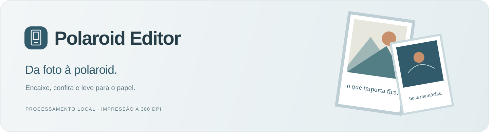
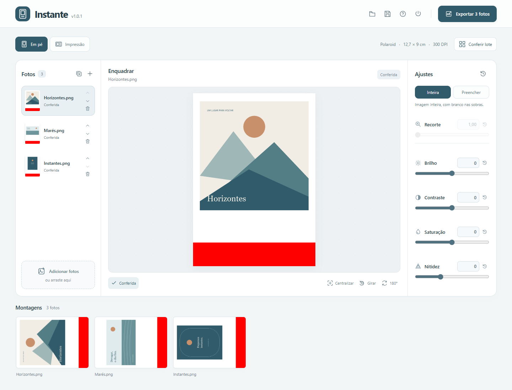

  

  
   Windows 10 e 11 · 64 bits · Instalação sem administrador

<a href="https://github.com/redlab-coder/instante/releases/latest">Versões e edição portátil</a> · <a href="docs/usage.md">Guia de uso</a>

## Da foto à polaroid

1. **Adicione suas fotos.** O lote recebe o encaixe e sugestões locais de orientação.
2. **Confira em pé.** Corrija os giros e veja o arquivo na orientação de impressão.
3. **Exporte as montagens** ou salve o lote para continuar depois.

## O essencial

- **Medidas definidas.** Foto de 8 × 8 cm em uma folha de 12,7 × 9 cm, a 300 DPI, com faixa vermelha para o corte.
- **Encaixe simples.** Imagem inteira com preenchimento branco ou recorte escolhido por você.
- **Conferência em lote.** Miniaturas, navegação por teclado e download individual.
- **Continuidade.** Arquivos `.instante` guardam cópias das fotos e seus ajustes.
- **Trabalho local.** Edição offline, originais preservados e atualizações na versão instalada.

A orientação sugerida precisa de conferência, especialmente em desenhos e colagens. Imprima em **tamanho real / 100%** e valide uma amostra antes da produção.

---

[Documentação](docs/README.md) · [Medidas](docs/printing.md) · [Desenvolvimento](docs/development.md) · [Histórico](CHANGELOG.md) · [Contribuir](CONTRIBUTING.md)
