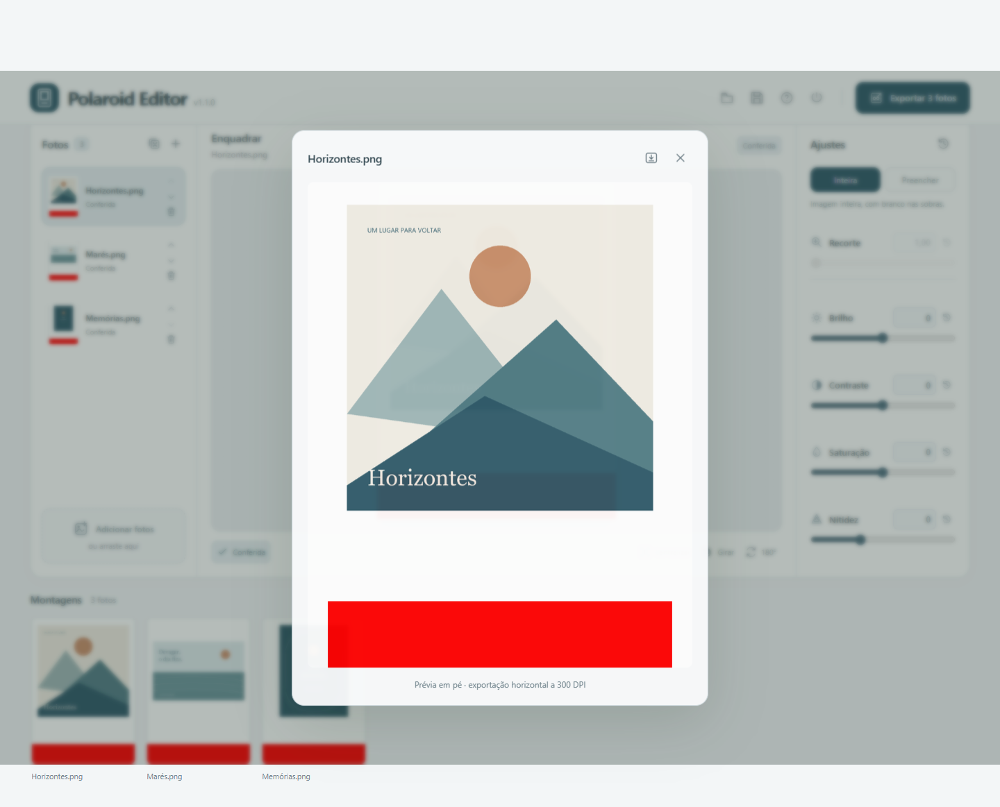

# Medidas e impressão

| Elemento | Especificação |
|---|---|
| Arquivo horizontal | 1500 × 1063 px, aproximadamente 12,7 × 9 cm |
| Foto preparada | 945 × 945 px, aproximadamente 8 × 8 cm |
| Resolução registrada | 300 DPI |
| Encaixe | x=70, y=59; termina antes de x=1015, y=1004 |
| Faixa de corte | Vermelho RGB 255,0,0; colunas 1295 a 1499 |
| Saída | JPG, qualidade 100, sem subamostragem cromática, perfil sRGB |

As conversões de centímetros para pixels são arredondadas. 945 pixels a 300 DPI representam aproximadamente 8,001 cm. O encaixe preserva o centro da abertura de referência, corrigindo seu tamanho para quadrado.

O topo visual da foto aponta para a esquerda; sua base aponta para a faixa vermelha. Todas as prévias giram a composição completa para apresentá-la em pé apenas na tela. A saída mantém a orientação horizontal e a faixa vermelha, pois ela faz parte do corte.

No modo Inteira, a foto é redimensionada proporcionalmente e acomodada sobre branco. Preencher usa um recorte quadrado explícito. Não há espelhamento, remoção de bordas ou alteração automática de cores. A orientação sugerida é revisável e não assegura que todos os conteúdos sejam reconhecidos.

O aplicativo define os pixels e os metadados. O programa da impressora pode redimensionar a folha; escolha tamanho real e meça uma amostra física antes da produção.

[← Documentação](README.md)
